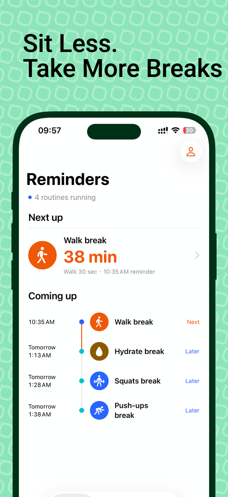
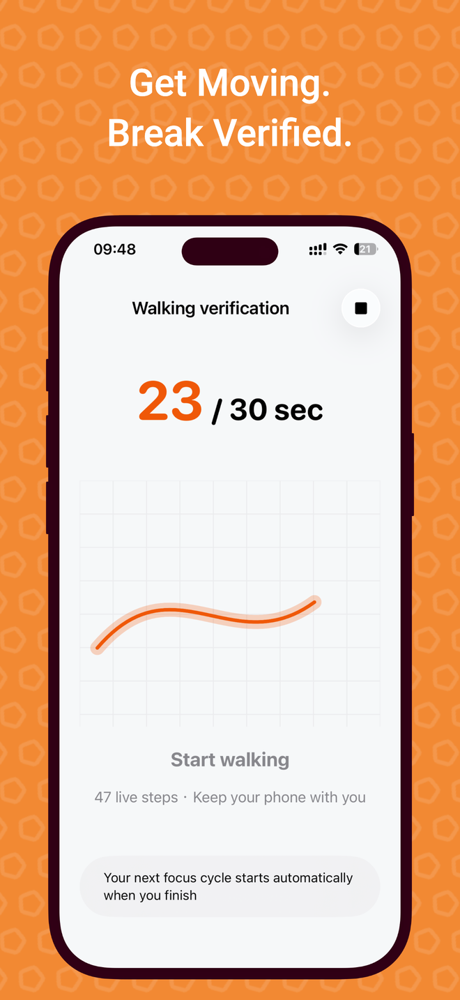
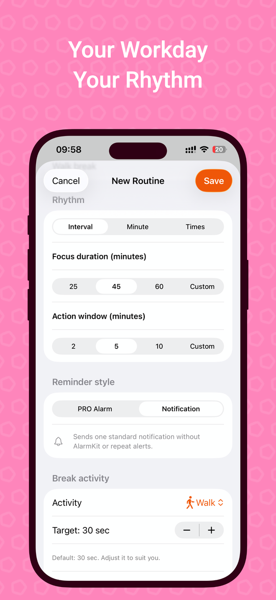

  

<h1 align="center">iCadence</h1>

<strong>Make the break part of your workday.</strong> Break reminders, movement verification, and a rhythm that starts again when you finish.

  <strong>English</strong> · <a href="README.zh-CN.md">简体中文</a> 
  <a href="https://apps.apple.com/app/id6751627034">Download on the App Store</a> ·
  <a href="https://www.qinfu-cloud.cn/health/en/">Product website</a> ·
  <a href="docs/en/faq.md">FAQ</a>

iPhone · iOS 18.6+ · English & Simplified Chinese · Free with in-app purchases

---

## A reminder is the beginning

Long coding sessions, study blocks, and busy afternoons can turn into hours at a desk. iCadence is a **break reminder and stand up reminder for iPhone** that connects the reminder to a short activity: walk, stretch, stand, or take a moment away from the screen.

For interval routines, completing a break starts the next work interval from your completion time. Your desk break becomes part of the rhythm, with a record of what actually happened.

## See your rhythm

  
  
  

Plan your day · Take a verified walking break · Set your own routine

Screenshots use existing iCadence promotional artwork. Some screens show Pro features; appearance may vary by version and settings.

## Built around the break

| Capability | What it means for your day |
| --- | --- |
| **Flexible routines** | Choose intervals, specific minutes each hour, or fixed daily times, with selected days and working time windows. |
| **Walking verification** | Carry your iPhone and use motion sensors to confirm a short walk. Keep the activity screen open while verifying. |
| **On-device pose detection · Pro** | Use the camera to help confirm standing, stretching, squats, jumping jacks, or push-ups. Frames are processed on device and are not saved or uploaded. |
| **Guided pauses** | Use timed activities for eye breaks, drinking water, and breathing. These are guided timers, not sensor verification. |
| **Quiet Periods** | Pause interruptions across routines for a meeting or a break, using quick durations, custom times, or repeating periods. |
| **Glanceable widgets** | View upcoming breaks, actions, and Quiet Period status on Home Screen and Lock Screen widgets. |
| **Stronger reminders · Pro** | Choose an AlarmKit alarm on iOS 26 or later, where supported and permitted. Ordinary notifications remain available. |
| **A useful history · Pro** | Review verified, manually confirmed, and missed breaks, with history and trends. |

## From a notification to a completed break

1. **Set a routine.** Choose when you work, when to be reminded, and a short activity.
2. **Take the break.** Open the activity from your reminder and follow its verification or timer.
3. **Begin again.** Complete an interval break to start the next work countdown from that moment.

Dismissing a notification does not count as a verified break. Sensor verification, guided timers, and manual confirmation have different meanings in your history. That distinction is central to iCadence.

## Start free, grow with Pro

Start with **one basic routine using ordinary notifications**, such as a walking or guided-timer break. Pro unlocks multiple routines, camera verification, stronger reminders, full history, and iCloud sync.

Choose an annual subscription or a lifetime purchase. Any trial eligibility and current pricing are shown before purchase in the App Store. [Read the FAQ](docs/en/faq.md#is-icadence-free) for details.

<a href="https://apps.apple.com/app/id6751627034"><strong>Find your workday rhythm — download iCadence</strong></a>

If the App Store redirects to its home page in your region, use the [China storefront in English](https://apps.apple.com/cn/app/id6751627034?l=en-US).

## Help & updates

- [Frequently asked questions](docs/en/faq.md) · [Release notes](CHANGELOG.md)
- [Official support](https://www.qinfu-cloud.cn/health/en/support) · [Privacy policy](https://www.qinfu-cloud.cn/health/en/privacy)
- User support: [support@qinfu-cloud.cn](mailto:support@qinfu-cloud.cn)
- Developer and business inquiries: [developer@qinfu-cloud.cn](mailto:developer@qinfu-cloud.cn)

When reporting a problem, include your iCadence version, iOS version, device model, and steps to reproduce it. Please keep personal health data and purchase receipts out of public issues.

---

Made by **Qinfu Tech · Shanghai Qinfu Information Technology Co., Ltd.**

[Company website](https://www.qinfu-cloud.cn) · [Qinfu Tech on GitHub](https://github.com/qinfu-tech)

This is the official product showcase and help repository. The commercial app source code is not distributed here. Product screenshots and brand assets remain the property of Qinfu Tech; no open-source license is granted for the app or these assets.
