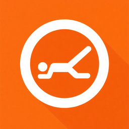
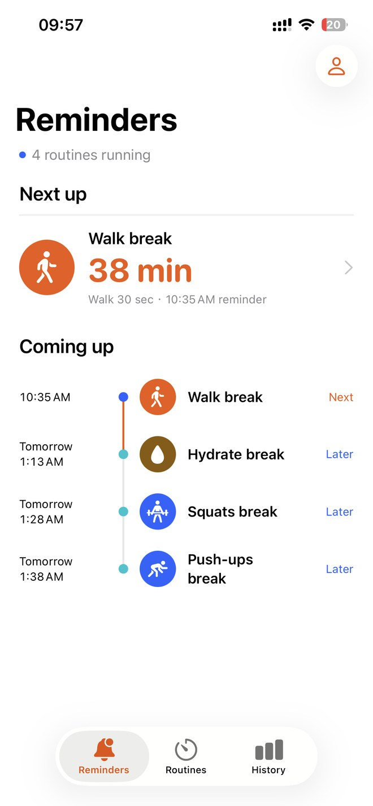
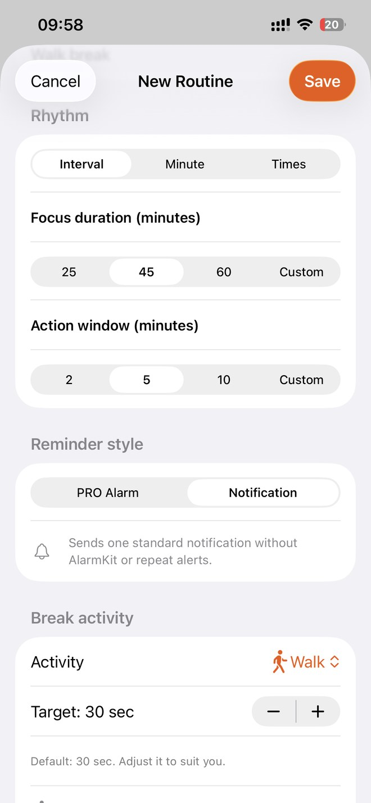
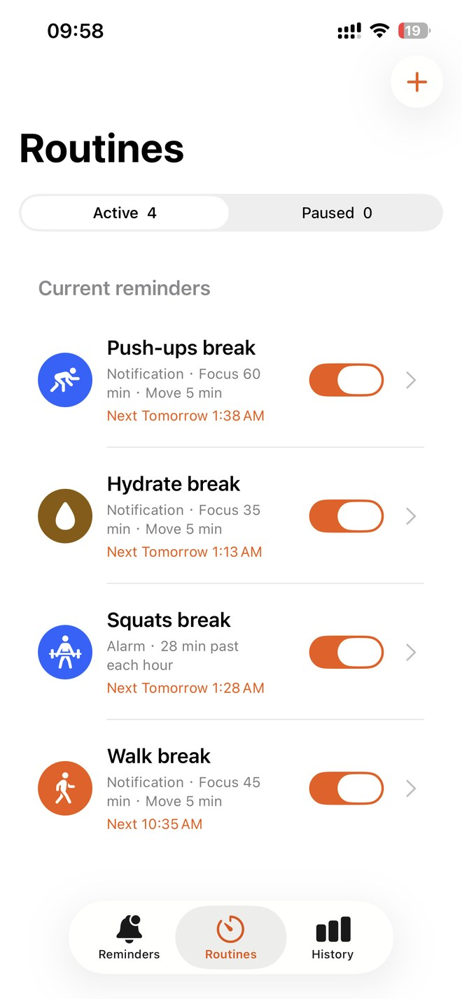
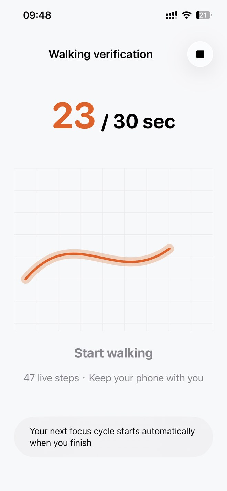
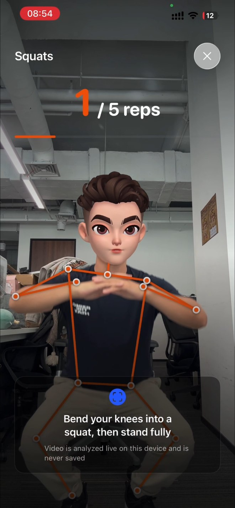
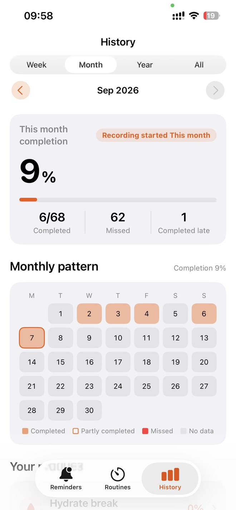
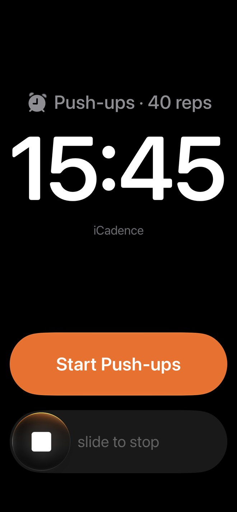
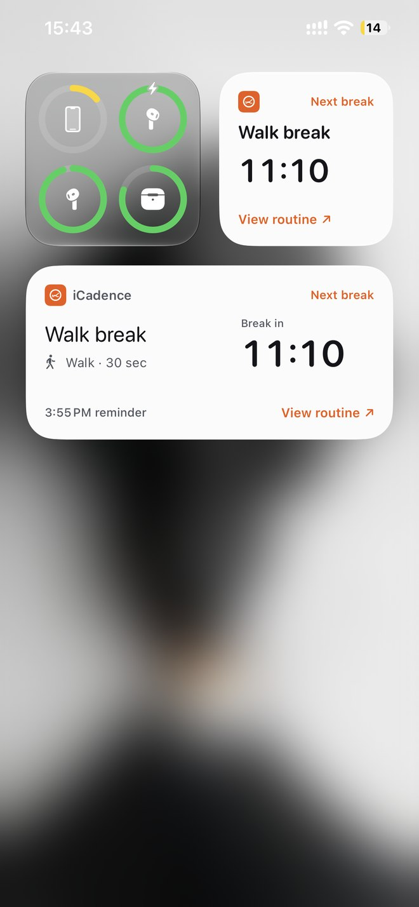
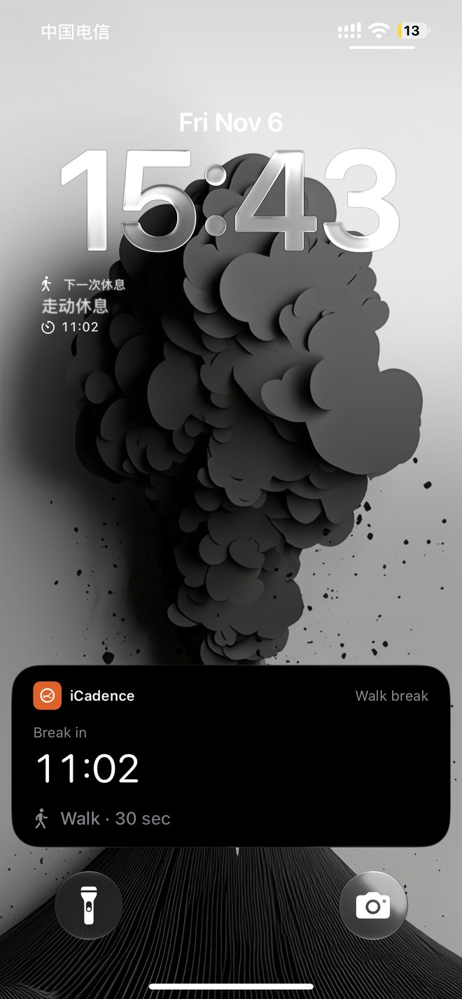

  

<h1 align="center">iCadence</h1>

<strong>Make the break part of your workday.</strong> Break reminders, movement verification, and a rhythm that starts again when you finish.

  <strong>English</strong> · <a href="README.zh-CN.md">简体中文</a> 
  <a href="https://apps.apple.com/app/id6751627034">Download on the App Store</a> ·
  <a href="https://www.qinfu-cloud.cn/health/en/">Product website</a> ·
  <a href="docs/en/faq.md">FAQ</a>

iPhone · iOS 18.6+ · English & Simplified Chinese · Free with in-app purchases

---

## A reminder is the beginning

Long coding sessions, study blocks, and busy afternoons can turn into hours at a desk. iCadence is a **break reminder and stand up reminder for iPhone** that connects the reminder to a short activity: walk, stretch, stand, or take a moment away from the screen.

For interval routines, completing a break starts the next work interval from your completion time. Your desk break becomes part of the rhythm, with a record of what actually happened.

## Screenshots and video

[Watch the full English demo (17 sec)](https://raw.githubusercontent.com/qinfu-tech/icadence/main/assets/videos/routines-en.mp4) · [Chinese walkthrough excerpt](https://raw.githubusercontent.com/qinfu-tech/icadence/main/assets/videos/routines-zh-CN.mp4)

See squat counting, routine editing, and break history. Some screens show Pro or an earlier interface. Select a screenshot to enlarge it.

### 01 · Plan a break

   &emsp;
   &emsp;
  

Upcoming breaks · Set your timing · Manage routines

### 02 · Move and review

   &emsp;
   &emsp;
  

Walking verification · Camera rep counting · Pro · Break history · Pro

### 03 · On your iPhone

   &emsp;
   &emsp;
  

System alarm · Pro · Home Screen widgets · Live Activity · Preview

The Live Activity card at the bottom of the Lock Screen is a development preview; availability in the current App Store release has not been verified. The released app supports Home Screen and Lock Screen widgets. The avatar in the camera demo covers the face.

## What iCadence can do

### 1. Schedule breaks around your work

- **Work intervals:** Work for 45 minutes, for example, then take a break. Completing it starts the next countdown from that moment. If you miss the break, the next interval starts after the action window closes.
- **Selected minutes each hour:** Get reminders at :25 and :55, for example.
- **Fixed daily times:** Set reminders for times such as 10:30 a.m. and 3:30 p.m. Hourly and fixed-time routines follow the clock.
- Choose active days and working hours, such as weekdays from 9 a.m. to 6 p.m. See your next break and upcoming reminders, and turn individual routines on or off.

### 2. Take the break you planned

Open the activity screen from the reminder and follow the activity you chose:

| Mode | What you can do |
| --- | --- |
| **Walking verification** | Carry your iPhone, allow Motion & Fitness access, and keep the activity screen open. Motion sensors detect walking and the app shows your progress. |
| **Guided timers** | Set aside time for an eye break, water, or breathing. A timer doesn't verify that you did the activity. |
| **Camera-assisted pose detection · Pro** | Verify supported standing, stretching, squats, jumping jacks, and push-ups. Set a duration or repetition target, depending on the activity. Camera frames are processed on device and are never saved or uploaded. |

### 3. Manage interruptions and see what's next

- **Standard notifications** are scheduled through iOS and do not require the app to stay open. Delivery depends on system permissions and settings such as Focus.
- **Stronger reminders (Pro)** use AlarmKit on supported devices running iOS 26 or later, with permission. Open the activity from the system alarm.
- **Quiet Periods** pause all routines on your device for a quick duration, a custom time window, or on a repeating schedule. Interval routines restart their countdown when the quiet period ends; missed reminders aren't sent in a batch.
- **Home Screen and Lock Screen widgets** show the next break, current activity, or Quiet Period status.

### 4. Review your breaks · Pro

Check your history and trends by week, month, year, or all time, and see completion by routine. History distinguishes sensor-verified, manually confirmed, and missed breaks. Dismissing a notification doesn't count as verification. Optional iCloud sync shares supported routines and history across devices signed in to the same iCloud account. Raw camera frames, raw motion data, and Quiet Period settings aren't synced.

## Start free, grow with Pro

Start with **one basic routine using ordinary notifications**, such as a walking or guided-timer break. Pro unlocks multiple routines, camera verification, stronger reminders, full history, and iCloud sync.

Choose an annual subscription or a lifetime purchase. Any trial eligibility and current pricing are shown before purchase in the App Store. [Read the FAQ](docs/en/faq.md#is-icadence-free) for details.

<a href="https://apps.apple.com/app/id6751627034"><strong>Find your workday rhythm — download iCadence</strong></a>

If the App Store redirects to its home page in your region, use the [China storefront in English](https://apps.apple.com/cn/app/id6751627034?l=en-US).

## Help & updates

- [Frequently asked questions](docs/en/faq.md) · [Release notes](CHANGELOG.md)
- [Official support](https://www.qinfu-cloud.cn/health/en/support) · [Privacy policy](https://www.qinfu-cloud.cn/health/en/privacy)
- User support: [support@qinfu-cloud.cn](mailto:support@qinfu-cloud.cn)
- Developer and business inquiries: [developer@qinfu-cloud.cn](mailto:developer@qinfu-cloud.cn)

When reporting a problem, include your iCadence version, iOS version, device model, and steps to reproduce it. Please keep personal health data and purchase receipts out of public issues.

---

Made by **Qinfu Tech · Shanghai Qinfu Information Technology Co., Ltd.**

[Company website](https://www.qinfu-cloud.cn) · [Qinfu Tech on GitHub](https://github.com/qinfu-tech)

This is the official product showcase and help repository. The commercial app source code is not distributed here. Product screenshots and brand assets remain the property of Qinfu Tech; no open-source license is granted for the app or these assets.
