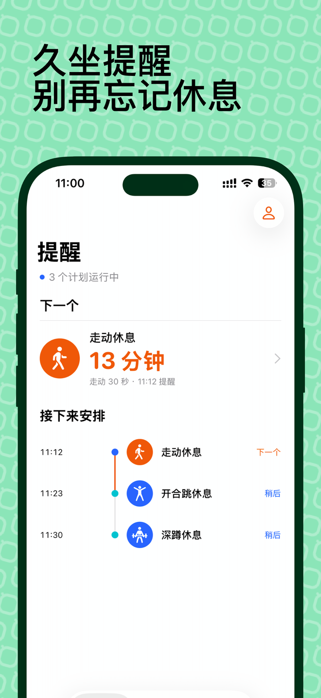
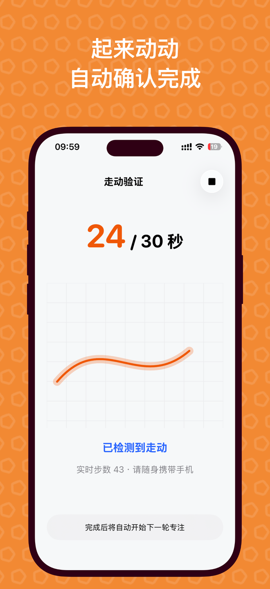
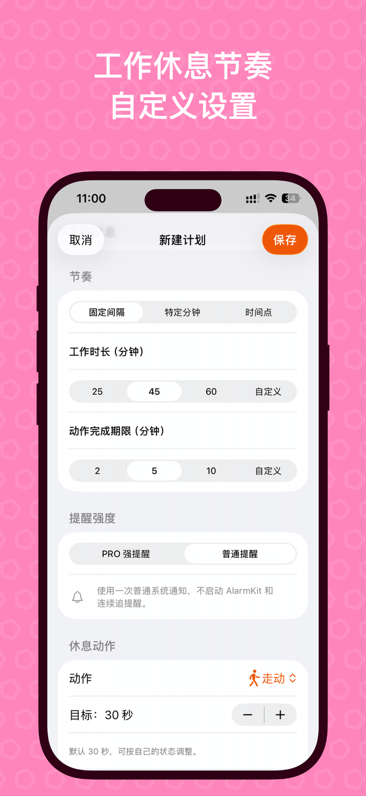

  

<h1 align="center">iCadence</h1>

<strong>让休息，成为工作节奏的一部分。</strong> 从提醒到行动，完成一次休息，再开始下一轮专注。

  <a href="README.md">English</a> · <strong>简体中文</strong> 
  <a href="https://apps.apple.com/app/id6751627034">在 App Store 下载</a> ·
  <a href="https://www.qinfu-cloud.cn/health/">产品官网</a> ·
  <a href="docs/zh-CN/faq.md">常见问题</a>

iPhone · iOS 18.6 及以上 · 英文与简体中文 · 免费下载，含 App 内购买

---

## 提醒，是一次休息的起点

写代码、赶方案、备考，一投入就容易在桌前坐上几个小时。iCadence 是为长时间伏案工作和学习设计的**久坐提醒与工作休息提醒 App**：收到提醒后，走动一下、站起来、拉伸，或者让眼睛暂时离开屏幕。

使用间隔计划时，完成休息会从完成时刻重新开始下一轮工作计时。休息成为节奏的一部分，也留下真实的完成记录。

## 看见自己的节奏

  
  
  

安排一天的节奏 · 完成一次走动休息 · 自定义适合自己的计划

图片复用 iCadence 现有宣传素材。部分页面展示 Pro 功能；实际界面可能随版本和设置有所不同。

## 围绕真实休息设计

| 功能 | 为日常工作带来的帮助 |
| --- | --- |
| **灵活安排节奏** | 支持固定间隔、每小时指定分钟、每日固定时刻，并设置生效星期和工作时间段。 |
| **走动验证** | 随身携带 iPhone，通过运动传感器确认短暂走动；验证时保持动作页面开启。 |
| **设备端姿态识别 · Pro** | 借助相机辅助确认站立、拉伸、深蹲、开合跳和俯卧撑。画面仅在设备端处理，不保存、不上传。 |
| **引导式休息** | 为护眼、喝水和深呼吸提供计时引导；这些活动通过计时完成，不属于传感器验证。 |
| **免提醒时段** | 开会或暂时不希望被打断时，统一暂停各计划的提醒；支持快捷时长、自定义时间和重复设置。 |
| **小组件一眼可见** | 在主屏幕和锁定屏幕查看下一次休息、当前动作和免提醒状态。 |
| **更强的提醒 · Pro** | 在支持并授权的 iOS 26 及以上设备上使用 AlarmKit 闹钟，也可选择普通通知。 |
| **有区分的历史 · Pro** | 查看已验证、自行确认和未完成的休息记录，以及历史和趋势。 |

## 从收到提醒，到完成一次休息

1. **设置计划。** 选好工作时间、提醒方式和一个短暂活动。
2. **开始休息。** 从提醒进入动作页，按照提示完成验证或计时。
3. **继续下一轮。** 完成间隔计划的休息后，从此刻重新开始工作倒计时。

划掉通知不会算作已验证休息。传感器验证、引导计时和自行确认，在历史中有不同的含义。iCadence 希望帮你看见的，就是这些真实发生的休息。

## 从免费基础计划开始

免费版可创建并运行 **1 个使用普通通知的基础计划**，例如走动或引导计时休息。Pro 解锁多个计划、相机验证、强提醒、完整历史及 iCloud 同步。

Pro 提供年度订阅和终身买断。免费试用资格与实际价格以 App Store 购买页面为准，详情见[常见问题](docs/zh-CN/faq.md#icadence-免费吗)。

<a href="https://apps.apple.com/app/id6751627034"><strong>在 App Store 下载 iCadence，找到自己的工作休息节奏</strong></a>

如果 App Store 自动跳转到首页，可使用[中国区下载入口](https://apps.apple.com/cn/app/id6751627034)。

## 帮助与更新

- [常见问题](docs/zh-CN/faq.md) · [更新记录](CHANGELOG.md)
- [官方支持](https://www.qinfu-cloud.cn/health/support) · [隐私政策](https://www.qinfu-cloud.cn/health/privacy)
- 用户支持：[support@qinfu-cloud.cn](mailto:support@qinfu-cloud.cn)
- 开发者及商务联系：[developer@qinfu-cloud.cn](mailto:developer@qinfu-cloud.cn)

反馈问题时，请提供 iCadence 版本、iOS 版本、设备型号和复现步骤。请勿在公开 Issue 中发布个人健康数据或购买凭据。

---

由 **秦伏科技 · 上海秦伏信息科技有限公司** 开发。

[公司官网](https://www.qinfu-cloud.cn) · [秦伏科技 GitHub](https://github.com/qinfu-tech)

本仓库为官方产品展示与帮助中心，不分发商业 App 源代码。产品截图及品牌素材归秦伏科技所有，本仓库不授予 App 或素材的开源许可。
