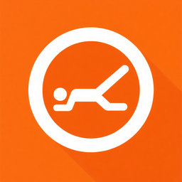
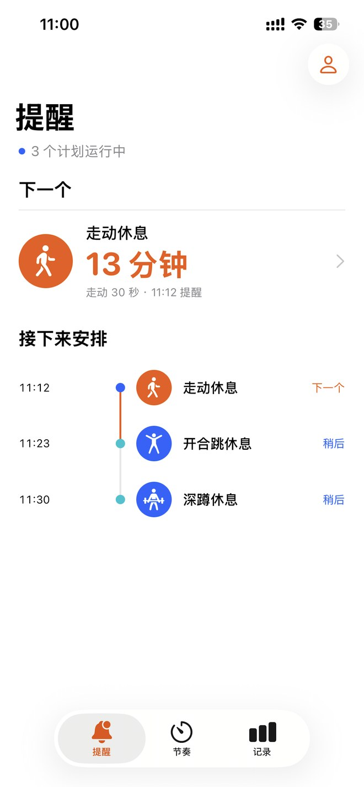
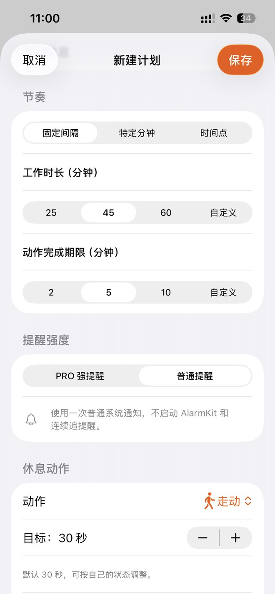
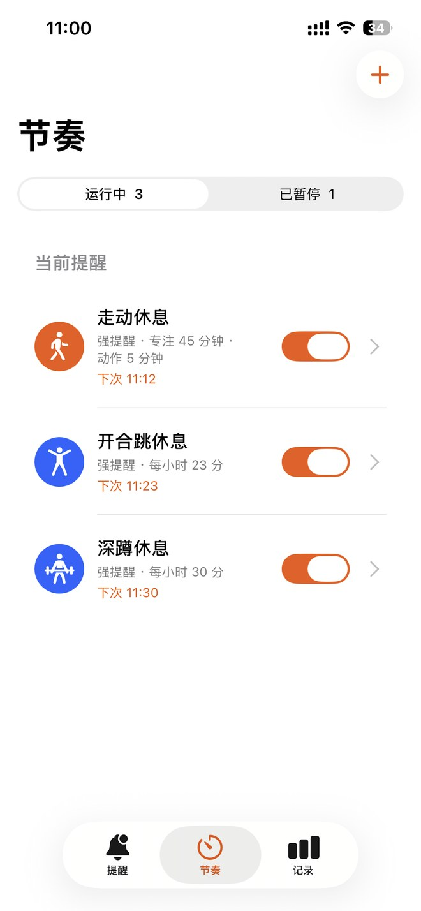
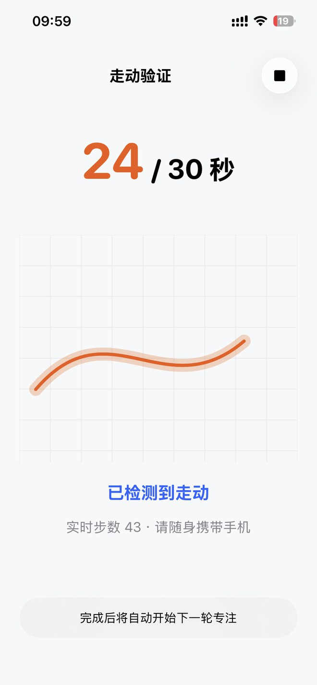
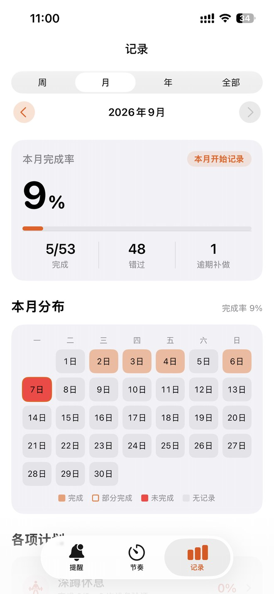
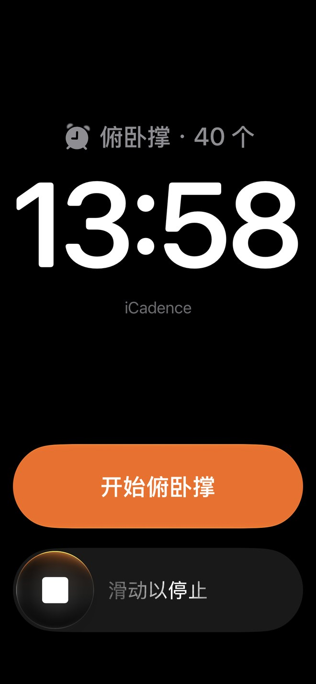

  

<h1 align="center">iCadence</h1>

<strong>让休息，成为工作节奏的一部分。</strong> 从提醒到行动，完成一次休息，再开始下一轮专注。

  <a href="README.md">English</a> · <strong>简体中文</strong> 
  <a href="https://apps.apple.com/app/id6751627034">在 App Store 下载</a> ·
  <a href="https://www.qinfu-cloud.cn/health/">产品官网</a> ·
  <a href="docs/zh-CN/faq.md">常见问题</a>

iPhone · iOS 18.6 及以上 · 英文与简体中文 · 免费下载，含 App 内购买

---

## 提醒，是一次休息的起点

写代码、赶方案、备考，一投入就容易在桌前坐上几个小时。iCadence 是为长时间伏案工作和学习设计的**久坐提醒与工作休息提醒 App**：收到提醒后，走动一下、站起来、拉伸，或者让眼睛暂时离开屏幕。

使用间隔计划时，完成休息会从完成时刻重新开始下一轮工作计时。休息成为节奏的一部分，也留下真实的完成记录。

## 实际界面与操作演示

以下为 iPhone 系统截图。部分画面展示 Pro 功能，界面可能随 iOS 版本和设置而不同。

  
  
  

提醒时间线 · 计划编辑 · 节奏列表

  
  
  

走动验证 · 休息记录 · 系统闹钟

[观看中文操作演示（MP4）](https://raw.githubusercontent.com/qinfu-tech/icadence/main/assets/videos/routines-zh-CN.mp4)：查看计划列表、编辑工作时段，再进入历史记录。演示为较早版本的实录，按钮位置可能有所不同。

## iCadence 能做什么

### 1. 按工作安排设提醒

- **固定间隔**：例如工作 45 分钟后休息。完成休息后，从完成时刻重新开始下一轮工作倒计时；如果没完成，动作完成期结束后才进入下一轮。
- **每小时指定分钟**：例如每小时的第 25、55 分钟提醒。
- **每日固定时刻**：例如每天 10:30、15:30 提醒。指定分钟和固定时刻按设定的钟点运行。
- 为计划设置生效星期和工作时间段，例如周一至周五 9:00–18:00。首页能查看下一次休息和后续安排；在节奏列表启用或暂停单个计划。

### 2. 让提醒带你完成一次休息

收到提醒后进入动作页，按计划选择的方式休息：

| 方式 | 可以做什么 |
| --- | --- |
| **走动验证** | 随身携带 iPhone，允许「运动与健身」权限，并保持动作页开启。运动传感器检测走动，页面显示进度。 |
| **引导计时** | 给护眼、喝水、深呼吸留出一段时间。计时结束不会证明你做了这些动作。 |
| **相机姿态识别 · Pro** | 辅助确认站立、拉伸、深蹲、开合跳和俯卧撑。可按动作设定时长或次数；识别画面在设备上处理，不保存、不上传。 |

### 3. 管理打扰，随时查看下一步

- **普通通知**由系统预先安排，不要求一直打开 App；实际投递受通知权限和专注模式等系统设置影响。
- **强提醒（Pro）**在支持并授权的 iOS 26 及以上设备上使用 AlarmKit，可从系统闹钟进入动作页。
- **免提醒时段**可临时暂停当前设备上的全部计划，支持快捷时长、自定义起止时间或重复安排。间隔计划在免提醒结束后重新计时，不集中补发。
- **主屏幕和锁定屏幕小组件**可查看下一次休息、当前动作和免提醒状态。

### 4. 回看休息情况 · Pro

按周、月、年或全部时间查看休息记录与趋势，并按计划回看完成情况。历史区分传感器验证、自行确认和未完成；划掉通知不会算作已验证休息。可在设置中开启 iCloud 同步，在同一 iCloud 账号下同步支持的计划和历史；原始相机画面、运动数据和免提醒设置不参与同步。

## 从免费基础计划开始

免费版可创建并运行 **1 个使用普通通知的基础计划**，例如走动或引导计时休息。Pro 解锁多个计划、相机验证、强提醒、完整历史及 iCloud 同步。

Pro 提供年度订阅和终身买断。免费试用资格与实际价格以 App Store 购买页面为准，详情见[常见问题](docs/zh-CN/faq.md#icadence-免费吗)。

<a href="https://apps.apple.com/app/id6751627034"><strong>在 App Store 下载 iCadence，找到自己的工作休息节奏</strong></a>

如果 App Store 自动跳转到首页，可使用[中国区下载入口](https://apps.apple.com/cn/app/id6751627034)。

## 帮助与更新

- [常见问题](docs/zh-CN/faq.md) · [更新记录](CHANGELOG.md)
- [官方支持](https://www.qinfu-cloud.cn/health/support) · [隐私政策](https://www.qinfu-cloud.cn/health/privacy)
- 用户支持：[support@qinfu-cloud.cn](mailto:support@qinfu-cloud.cn)
- 开发者及商务联系：[developer@qinfu-cloud.cn](mailto:developer@qinfu-cloud.cn)

反馈问题时，请提供 iCadence 版本、iOS 版本、设备型号和复现步骤。请勿在公开 Issue 中发布个人健康数据或购买凭据。

---

由 **秦伏科技 · 上海秦伏信息科技有限公司** 开发。

[公司官网](https://www.qinfu-cloud.cn) · [秦伏科技 GitHub](https://github.com/qinfu-tech)

本仓库为官方产品展示与帮助中心，不分发商业 App 源代码。产品截图及品牌素材归秦伏科技所有，本仓库不授予 App 或素材的开源许可。
